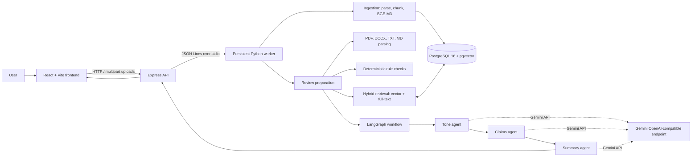

<div align="center">
  
  <h1>TrueLine</h1>
  <p><strong>Evidence-grounded brand governance for content review.</strong></p>
  <p>Ingest an organization's approved guidance, review draft content against it, and return cited findings for a human to assess.</p>
  <p>
    
    
    
    
    
    
    
  </p>
</div>

---

## What TrueLine does

TrueLine is a local hackathon prototype for checking marketing and other organization-authored content against an approved knowledge library. An organization uploads reference files (brand guidance, tone guidance, approved claims, product facts, and related resources), chooses a type for each file, and then submits a document for review. The review combines deterministic checks with retrieval-augmented generation (RAG): relevant source passages are retrieved from PostgreSQL, specialized model calls assess tone and claims, and a final model produces a Markdown summary with evidence citations.

The current baseline is a single-organization, one-active-session prototype. It is intended for local evaluation and demos, not as a production multi-tenant service.

## At a glance

1. Start a session. The API clears the previous session's indexed knowledge and creates a new isolated knowledge scope.
2. Upload one or more reference files and assign a document type to each. Each file is parsed, chunked, embedded with BGE-M3, and stored in PostgreSQL with its source, version, and type metadata.
3. Upload a draft to review and optionally select its channel. The backend parses it, runs available structured deterministic rules, and retrieves relevant passages.
4. LangGraph runs the tone agent, claims agent, and summarizer in sequence. The frontend renders the summary as Markdown and shows findings and citations.
5. End the session when finished. The prototype deletes the session's sources, versions, chunks, and embeddings so a later session starts clean.

## Architecture



### Components

| Component | Responsibility |
| --- | --- |
| `frontend/` | React/Vite interface for session control, reference uploads, and document review. Summary text is rendered as GitHub-flavored Markdown. |
| `backend/` | Express HTTP API, multipart upload validation, session-aware requests, and a long-lived Python worker bridge. Loads `backend/.env`. |
| `data_ingestion/` | PostgreSQL schema/migrations, source/version management, chunking, embeddings, hybrid search, and ephemeral session cleanup. |
| `rag/parsing/` | Extracts text and location metadata from PDF, DOCX, Markdown, and plain text files. Sparse image-heavy PDF pages use adaptive Tesseract OCR. |
| `rag/rules/` | Evaluates structured deterministic rules supplied with an ingested source. It does not turn natural-language policy prose into executable rules. |
| `rag/retrieval/` | Adapts the ingestion search interface and retrieves evidence for review passages while preserving source and location information. |
| `rag/agentic/` | LangGraph tone, claims, logo comparison, and summary nodes; each node has its own provider, model, endpoint, key, and timeout settings. |

### Review workflow

1. **Parse.** The uploaded review file is decoded and parsed into text segments and source locations.
2. **Check deterministic rules.** The backend loads approved structured rules for the active session and requested channel, then runs terminology and required-text checks. If no structured rules were supplied, this stage has no rules to apply.
3. **Retrieve context.** Parsed passages are used as search queries. PostgreSQL combines BGE-M3 vector similarity with PostgreSQL full-text search and Reciprocal Rank Fusion. Results are scoped to the active session and carry source/version/chunk identifiers and document types.
4. **Review tone.** The tone agent searches tone-of-voice, brand-guideline, and glossary evidence. Findings are retained only when they cite a retrieved passage.
5. **Verify claims.** The claims agent searches approved claims, product facts, brand guidance, and legal/compliance references. Supported or contradicted claim findings require citations to approved-fact sources; without that evidence, a claim stays unverified.
6. **Summarize.** The summary agent receives the review context, deterministic findings, retrieved evidence, and both specialist results. It returns Markdown and keeps human review required.
7. **Render.** The API returns structured results and evidence to the frontend, which renders the Markdown summary and citation details.

The model steps are sequential: the claims agent receives the tone result, and the summarizer receives both earlier agent results. Model calls are independent per role even when all roles point to the same Gemini model.

## Requirements

- macOS, Linux, or Windows with Docker Desktop / Docker Engine and Docker Compose
- Node.js and npm (use a current Node.js LTS release)
- Python 3.11 or 3.12
  - A Gemini API key for each configured agent environment variable, including the logo agent when visual review is enabled
- Sufficient disk space and memory for the BGE-M3 dense embedding model. Its dense PyTorch checkpoint is approximately 2.27 GB and is downloaded to the Hugging Face cache on first model initialization; it is not stored in this repository.
- Tesseract OCR with English language data for scanned PDF pages. PyMuPDF and its Python package do not install the Tesseract executable.

The local database uses PostgreSQL 16 with the pgvector extension via the `pgvector/pgvector:pg16` container. It is exposed on host port `5433` to avoid the common local PostgreSQL port `5432`.

## Run locally

Run each service in a separate terminal from the repository root unless a step says otherwise.

### 1. Configure environment

Create the backend environment file and fill in all three agent keys:

```bash
cp backend/.env.example backend/.env
```

In `backend/.env`, set a valid value for each of:

```dotenv
TRUELINE_TONE_API_KEY=your_tone_agent_gemini_key
TRUELINE_CLAIMS_API_KEY=your_claims_agent_gemini_key
TRUELINE_SUMMARY_API_KEY=your_summary_agent_gemini_key
```

The template configures each role to use Google's OpenAI-compatible API endpoint and the same baseline model, `gemini-3.1-flash-lite`. Provider, base URL, model, timeout, and key remain separate variables for each role. Keep `backend/.env` private; it is ignored by Git. The Gemini-compatible endpoint format is described in [Google's Gemini API documentation](https://ai.google.dev/gemini-api/docs/openai).

`frontend/.env.example` sets `VITE_API_BASE_URL=http://localhost:3001`, which matches the backend default. Copy it only if you need to override that URL:

```bash
cp frontend/.env.example frontend/.env
```

Other backend settings in `backend/.env.example` include `PORT` (API port), `FRONTEND_ORIGIN` (CORS origin), `DATABASE_URL`, `TRUELINE_BRAND_ID` (the configured organization's internal scope), `TRUELINE_ORGANIZATION_NAME` (display/health metadata), and `PYTHON_BIN` (optional Python executable override). The default database URL and local Compose credentials are for development only.

### 2. Install Python dependencies

From the repository root:

```bash
python3.11 -m venv .venv
source .venv/bin/activate
python -m pip install --upgrade pip
pip install -r rag/requirements.txt -r data_ingestion/requirements.txt
```

On Windows PowerShell, activate with `.venv\Scripts\Activate.ps1`. The backend automatically uses this repository `.venv` if present. Otherwise, set `PYTHON_BIN` in `backend/.env` to the Python executable containing these dependencies.

Install Tesseract separately: on macOS use `brew install tesseract`; on Debian/Ubuntu use `sudo apt-get install tesseract-ocr tesseract-ocr-eng`; on Windows install the Tesseract OCR application and ensure its executable is on `PATH`. The backend host/container must have Tesseract available to the Python worker. This repository runs PostgreSQL in Docker but does not define a backend container, so install Tesseract on the machine or deployment image that runs `backend/python_worker.py`. Digital PDF text extraction and DOCX/TXT/Markdown parsing work without Tesseract.

The PDF parser OCRs a page only when native text is sparse and embedded images occupy at least 25% of the page. Tune `TRUELINE_OCR_MIN_CHARS` (default `40`), `TRUELINE_OCR_IMAGE_COVERAGE` (default `0.25`), and `TRUELINE_OCR_DPI` (default `200`, bounded to 120–300) in `backend/.env` if documents need different thresholds. OCR warnings are returned with parsed review documents and reference ingestion results. Reference PDF images are saved under `data_ingestion/extracted_assets/` (or `TRUELINE_ASSET_DIR`) with generated names and page/hash metadata stored on the source version; session reset/end removes these local artifacts. They are private local files with no public serving endpoint. A deployment with ephemeral disk will lose them on restart, so durable object storage is a future deployment requirement. Review-document images are not saved as approved reference assets. Vector-only page graphics are not currently rendered as fallback images.

### 3. Start the database

In a separate terminal, from the repository root:

```bash
cd data_ingestion
docker compose up -d db
```

The default database is `trueline`, user/password `trueline`/`trueline`, at `localhost:5433`. `backend/.env` has the matching `DATABASE_URL`. The Python worker applies pending migrations when it starts.

### 4. Start the API and Python worker

In a separate terminal, from the repository root:

```bash
cd backend
npm install
npm run dev
```

Wait for the `Python RAG worker ready (bge-m3)` message. The first startup initializes the model and downloads its dense checkpoint if it is not already cached. The API is available at `http://localhost:3001`; `http://localhost:3001/api/health` reports worker, embedding, and non-secret agent configuration status.

### 5. Start the frontend

In another terminal, from the repository root:

```bash
cd frontend
npm install
npm run dev
```

Open the Vite URL shown in the terminal (normally `http://localhost:5173`). The frontend communicates with the backend URL in `VITE_API_BASE_URL`.

### 6. Try a review

1. Start a session in the UI.
2. Upload reference files in the knowledge library. Choose a type per file: `brand_guidelines`, `tone_of_voice`, `approved_claims`, `product_facts`, `glossary`, `asset_rules`, `legal_compliance`, or `other_reference`.
3. Wait for ingestion and embedding to finish before navigating to review.
4. Upload a `.txt`, `.md`, `.pdf`, or `.docx` verification document and choose a channel if relevant.
5. Inspect the Markdown summary, deterministic findings, evidence, and citations. End the session to clear its data.

The API accepts one file per `/api/knowledge` or `/api/review` request (15 MiB maximum). Review uploads also accept PNG, JPEG, and WebP images; their text is OCRed locally. Approved logo references can be uploaded separately as PNG, JPEG, or WebP (5 MiB each, up to 12 per session). References and review visuals are private, session-scoped local assets. The logo agent receives only approved logo references and standalone document images that pass local visual-hash screening against those references; OCR text alone cannot make an image eligible. Full-page renders, charts, and unrelated images are not sent to Gemini. Vector-heavy pages may be rendered for local extraction, but are excluded from logo-agent input. Set `TRUELINE_LOGO_PROVIDER`, `TRUELINE_LOGO_BASE_URL`, `TRUELINE_LOGO_API_KEY`, `TRUELINE_LOGO_MODEL`, and `TRUELINE_LOGO_TIMEOUT_SECONDS` in `backend/.env`. The Python worker applies `data_ingestion/migrations/004_logos.sql` when it starts.

## Embedding and search configuration

The baseline uses **BAAI/bge-m3** through `sentence-transformers`, configured in `backend/.env`:

```dotenv
INGESTION_EMBEDDER=bge-m3
EMBEDDING_MODEL=BAAI/bge-m3
EMBEDDING_REVISION=main
```

BGE-M3 produces normalized dense embeddings of **1,024 dimensions**, matching the database's `vector(1024)` column. The embedding text includes the selected document type so retrieval can use that metadata to distinguish tone guidance, claims, facts, and other sources. The same model and revision must be used to embed sources and search queries. The code records an embedding-model tag and ignores vectors with a different tag during search.

Search combines dense vector distance and PostgreSQL full-text ranking, fused with Reciprocal Rank Fusion. Agent-specific document-type filters focus the tone and claims searches. The current migration does not enable an approximate-nearest-neighbor index; vector search scans the eligible rows, which is suitable for this small prototype dataset but should be revisited as the corpus grows.

For a lightweight plumbing-only local run, `INGESTION_EMBEDDER=fake` selects a deterministic fake embedder instead. Fake vectors are **not semantic embeddings**, must not be used to assess retrieval quality, and are incompatible with BGE-M3 vectors. Start a fresh session and re-upload the sources after changing the embedder; the prototype session reset clears the old index.

## Agent API configuration

Each graph role has an independent environment namespace. The checked-in `.env.example` sets provider, endpoint, model, and timeout individually; add a key to each variable in your private `backend/.env`:

| Role | API key | Default retrieval focus |
| --- | --- | --- |
| Tone | `TRUELINE_TONE_API_KEY` | Tone of voice, brand guidelines, glossary |
| Claims | `TRUELINE_CLAIMS_API_KEY` | Approved claims, product facts, brand guidelines, legal/compliance |
| Summary | `TRUELINE_SUMMARY_API_KEY` | Receives retrieved evidence and prior agent results |

Each role also has its own `*_PROVIDER`, `*_BASE_URL`, `*_MODEL`, and `*_TIMEOUT_SECONDS` variables. All currently use Gemini through `https://generativelanguage.googleapis.com/v1beta/openai/` and `gemini-3.1-flash-lite`; each role can later be changed independently. Local Ollama is also supported per role by setting its provider to `ollama`, its OpenAI-compatible endpoint (normally `http://localhost:11434/v1`), and a model available in Ollama. The API key value for Ollama is not used as a secret. No Gemini key is sent to the browser.

## HTTP API

The Express server listens on `PORT` (default `3001`) and allows the frontend origin in `FRONTEND_ORIGIN` (default `http://localhost:5173`). Upload endpoints use `multipart/form-data`.

| Method and path | Purpose |
| --- | --- |
| `GET /api/health` | Readiness, embedder name, workflow name, and safe agent model configuration (never keys). |
| `POST /api/session/start` | Clear previous indexed knowledge and start the sole active session. |
| `POST /api/session/resume` | Resume the currently active session using JSON `{ "sessionId": "..." }`. |
| `POST /api/session/stop` | End the session and clear all indexed knowledge. JSON `{ "sessionId": "..." }`. |
| `GET /api/knowledge?sessionId=...` | List indexed sources in the session. |
| `POST /api/knowledge` | Ingest one file. Form fields include `file`, `sessionId`, `documentType`, optional `title`, optional JSON-array `ruleData`, and optional `approved`. |
| `POST /api/review` | Review one file. Form fields include `file`, `sessionId`, and optional `channel`. |

The session identifier is a temporary scope token, not authentication. Every session-scoped endpoint verifies that it matches the active session and configured organization.

## Structured deterministic rules

Ingestion stores optional `ruleData` records alongside a source version. Approved, active records are loaded by the deterministic rule adapter. Supported rule kinds and fields are defined in `rag/rules/models.py`; for example:

```json
[
  {
    "rule_id": "preferred_product_name",
    "kind": "terminology",
    "mode": "replace_with_preferred",
    "term": "Tru Line",
    "replacement": "Trueline",
    "case_sensitive": false,
    "whole_word": true,
    "severity": "medium",
    "applies_to_channels": []
  }
]
```

The current UI supports reference-file uploads, but does not expose a dedicated structured-rule editor. Rules can be supplied through the API's `ruleData` field. Uploading prose such as a PDF brand book does not automatically extract executable deterministic rules; prose can still be embedded and retrieved as guidance for the agents.

## Data model and session assumptions

- PostgreSQL stores source identity, immutable source versions, parsed canonical text, structured rule JSON, chunks, document types, embedding metadata, and vectors.
- A chunk links to its source and source version and records its document type and location in canonical version text.
- A source is searchable only when its version is active and approved, its chunks have ready embeddings, and the stored model tag matches the configured embedder.
- This prototype allows **one configured organization and one active session at a time**. Session start clears all indexed knowledge, and session end deletes it. Do not use it when concurrent users or durable cross-session data are required.
- Database schema and migrations remain in place when session knowledge is cleared. Stopping Docker does not delete its named volume. To deliberately reset the local database volume itself, run `docker compose down -v` from `data_ingestion/`; this deletes database contents.

## Repository layout

```text
TrueLine/
├── assets/truline_logo.png
├── backend/                 Express API and Python worker bridge
├── data_ingestion/          PostgreSQL/pgvector schema and ingestion package
│   ├── migrations/          Versioned SQL schema migrations
│   ├── seed/                Optional demo knowledge records
│   ├── tests/               Ingestion and retrieval tests
│   └── trueline_ingestion/  Chunking, embeddings, persistence, search, sessions
├── frontend/                React + Vite client
├── rag/                     Parsing, deterministic checks, retrieval, LangGraph
└── README.md
```

Useful module guides: [RAG workflow](rag/RAG_WORKFLOW.md), [ingestion contract](data_ingestion/RAG_INGESTION_CONTRACT.md), and [ingestion README](data_ingestion/README.md).

## Troubleshooting

- **Database connection refused on port 5433:** start the database with `docker compose up -d db` from `data_ingestion/` and check `docker compose ps`.
- **Python worker fails during startup:** activate the repository `.venv`, install both requirement files, confirm the database is reachable, and check the error printed by `npm run dev`.
- **Model download or memory failure:** first BGE-M3 initialization downloads model weights and may need several GB of free disk and available memory. For plumbing checks only, use the fake embedder and re-upload sources in a fresh session.
- **Gemini request fails:** make sure all three per-agent API key variables are populated and that the endpoint/model are enabled for the key.
- **No relevant citations:** verify the source upload finished, is approved, has the right document type, and belongs to the current session. An agent should report insufficient evidence rather than fabricate support.
- **Review gives no deterministic findings:** confirm structured rules were sent as `ruleData`, were approved, and apply to the selected channel. Natural-language rules are not converted automatically.

## Development notes

Start the backend and frontend as described above. Optional ingestion tests use a disposable PostgreSQL database; see `data_ingestion/README.md` for setup. The test fixture drops `knowledge_*` tables, so never point `TEST_DATABASE_URL` at a database containing data you need.

## Current limitations

- No authentication, user accounts, authorization, or multi-tenant isolation; the session token is not an access-control mechanism.
- OCR quality depends on scan quality and the locally installed Tesseract language data. Logo screening compares extracted images with uploaded references and may miss logos that are substantially altered or embedded as page-level vector artwork.
- No natural-language policy-to-rule extraction or dedicated structured-rule editor in the UI.
- Agent outputs can be incomplete or wrong; a human must verify the evidence and conclusions.
- BGE-M3 uses a substantial local model download, and the current exact vector scan is intended for a small dataset.
- Model choice and endpoint are configured by a trusted local operator in `.env`; the UI does not accept user-supplied model endpoints or API keys.

## License

Distributed under the MIT License. See [LICENSE](LICENSE).
