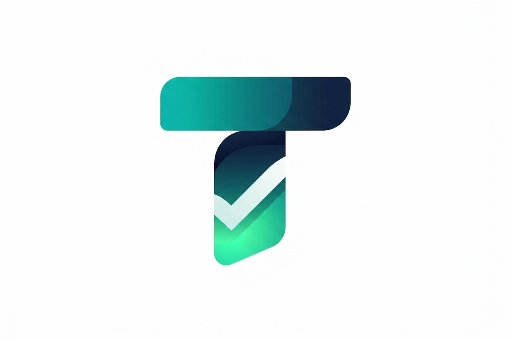
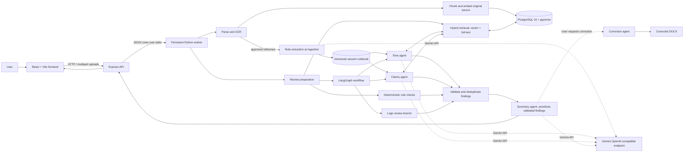

<div align="center">
  
  <h1>TrueLine</h1>
  <p><strong>Evidence-grounded brand governance for content review.</strong></p>
  <p>Ingest an organization's approved guidance, review draft content against it, and return cited findings for a human to assess.</p>
  <p>
    
    
    
    
    
    
    
  </p>
</div>

---

## What TrueLine does

TrueLine is a local hackathon prototype for checking marketing and other organization-authored content against an approved knowledge library. An organization uploads reference files (brand guidance, tone guidance, approved claims, product facts, and related resources), chooses a type for each file, and then submits a document for review. The review combines deterministic checks with retrieval-augmented generation (RAG): relevant source passages are retrieved from PostgreSQL, specialized model calls assess tone and claims, and the summary model prioritizes validated findings that the backend renders as a cited Markdown report.

The current baseline is a single-organization, one-active-session prototype. The `production` branch uses Gemini Embedding 2; `main` retains the local BGE-M3 embedder. Both use 1,024-dimensional vectors and the existing PostgreSQL `vector(1024)` schema. The prototype is intended for evaluation and demos, not as a production multi-tenant service.

## At a glance

1. Start a session. The API clears the previous session's indexed knowledge and creates a new isolated knowledge scope.
2. Upload reference files and assign document types. Approved files are parsed, rule-extracted once, and indexed; extracted rules and original passages are stored against the approved source version.
3. Upload a draft to review and optionally select its channel. The backend parses it, runs deterministic checks, and retrieves relevant passages.
4. Tone and Claims agents review the full draft with applicable session rules and deterministic results. Each may run at most three targeted RAG searches, then reassess once with the returned evidence. The logo reviewer remains a separate visual branch.
5. The backend validates and deduplicates deterministic and agent findings in a per-review buffer. The Summary agent can prioritize only those findings; the application renders the report from the validated buffer.
6. If the user requests a corrected version, the correction agent receives the original parsed document, active extracted rules, and final findings. The backend applies only exact-span edits and generates a DOCX draft for inspection.
7. End the session when finished. The prototype deletes the session's sources, versions, chunks, and embeddings so a later session starts clean.

## Architecture



### Components

| Component | Responsibility |
| --- | --- |
| `frontend/` | React/Vite interface for session control, reference uploads, and document review. Docker builds the Vite app and Express serves its static files; local development can use the Vite dev server. |
| `backend/` | Express HTTP API, production frontend hosting, multipart upload validation, session-aware requests, and a long-lived Python worker bridge. Loads `backend/.env`. |
| `data_ingestion/` | PostgreSQL schema/migrations, source/version management, chunking, embeddings, hybrid search, and ephemeral session cleanup. |
| `rag/parsing/` | Extracts text and location metadata from PDF, DOCX, Markdown, and plain text files. Sparse image-heavy PDF pages use adaptive Tesseract OCR. |
| `rag/rules/` | Evaluates machine-checkable structured rules supplied with an ingested source. Natural-language extracted rules are kept in the separate evidence-linked rulebook and reviewed by specialist agents. |
| `rag/retrieval/` | Adapts the ingestion search interface and retrieves evidence for review passages while preserving source and location information. |
| `rag/agentic/` | Ingestion-time rulebook extraction, LangGraph tone/claims/logo/summary review, and the on-demand correction agent; each model role has its own provider, model, endpoint, key, and timeout settings. |

### Review workflow

1. **Ingest references.** Approved references use the existing parsing and OCR pipeline. The extraction agent records explicit rules and facts—including every explicitly stated product price (regular/list, sale, promotional, and per-unit)—with exact quotations, source version, chunk, and page provenance. Prices retain the exact product name, amount, currency, conditions, quantity, and unit; missing values are not inferred. Original passages also continue through chunking and embedding. A single source over 80,000 parsed characters is not sent to rule extraction; its extraction status is marked insufficient, but indexing can continue.
2. **Parse the draft.** The uploaded review file is decoded and parsed into text segments and source locations.
3. **Check deterministic rules.** The backend loads approved machine-checkable rules for the active session and requested channel, then runs terminology and required-text checks.
4. **Retrieve and investigate.** Parsed passages get an initial hybrid retrieval snapshot. Tone and Claims receive the full review text, applicable active-version rulebook entries, deterministic results, and this snapshot. Claims also compares explicit draft prices, currencies, and other supported exact facts against extracted product facts; recognized price formats are normalized for comparison without treating different currencies as equal. Each agent can request at most three targeted searches, with up to five results each in its allowed document types, then reassess once. Missing evidence is not treated as proof of falsity.
5. **Validate and consolidate.** Exact review spans and source citations are checked against approved current-session evidence. Each Tone and Claims result is added to its own findings buffer with an exact-duplicate check; duplicate entries merge their validated citations. Distinct findings on the same sentence remain separate. Deterministic and specialist findings are then deduplicated in the per-review summary buffer.
6. **Summarize.** The summary model receives only the validated, deduplicated findings and returns an ordering hint using existing finding IDs. It is instructed not to select an issue more than once. It cannot add or reclassify findings; the application renders the report from the validated buffer. Human review remains required.
7. **Render.** The API returns structured results and evidence to the frontend, which renders the Markdown report and citations.
8. **Correct on request.** Only after the user clicks **Generate corrected DOCX**, a separate correction model receives the original parsed text, active extracted rules, and validated findings. It may propose exact-quote replacements only; mismatched/ambiguous quotes are skipped. The resulting DOCX is a draft and may not preserve the original layout or visuals.

Rule extraction runs once when each approved reference version is ingested. Tone, claims, and logo review run for each submitted draft; the summary model sees only the validated finding buffer. Correction runs only on user request. Model calls are independently configured per role even when all roles point to the same Gemini model.

## Requirements

- macOS, Linux, or Windows with Docker Desktop / Docker Engine and Docker Compose
- Node.js and npm (use a current Node.js LTS release)
- Python 3.11 or 3.12
- A Gemini Embedding API key for the production branch's embedding requests
- Separate Gemini API keys for each enabled agent role: extraction, tone, claims, summary, logo (if used), and correction (if used)
- Tesseract OCR with English language data for scanned PDF pages. PyMuPDF and its Python package do not install the Tesseract executable.

The local database uses PostgreSQL 16 with the pgvector extension via the `pgvector/pgvector:pg16` container. It is exposed on host port `5433` to avoid the common local PostgreSQL port `5432`.

## Run locally

Run each service in a separate terminal from the repository root unless a step says otherwise.

### Run the full stack with Docker Compose

Docker Compose starts PostgreSQL with pgvector and the Express/Python backend. The backend container builds and serves the React frontend from the same origin:

```bash
docker compose up --build
```

Open `http://localhost:3001`; the API health endpoint is `http://localhost:3001/api/health`. The first build installs the application dependencies. On `production`, embeddings are generated by Gemini and no local embedding checkpoint is downloaded. The local database is kept in a named Docker volume between runs. Press Ctrl+C to stop the services, then use `docker compose down` to remove the containers and network. Render deployment uses the managed Postgres service declared in `render.yaml`, not this local Compose database.

Before starting Compose, copy `backend/.env.example` to `backend/.env` and set `GEMINI_EMBEDDING_API_KEY`. Agent keys are needed for the model roles you use. Docker Compose reads this optional file automatically; without the embedding key, the Python worker cannot start in Gemini mode.

### 1. Configure environment

Create the backend environment file and fill in the API keys for the agents you enable:

```bash
cp backend/.env.example backend/.env
```

In `backend/.env`, set a valid value for each of:

```dotenv
TRUELINE_TONE_API_KEY=your_tone_agent_gemini_key
TRUELINE_EXTRACTION_API_KEY=your_extraction_agent_gemini_key
TRUELINE_CLAIMS_API_KEY=your_claims_agent_gemini_key
TRUELINE_SUMMARY_API_KEY=your_summary_agent_gemini_key
TRUELINE_LOGO_API_KEY=your_logo_agent_gemini_key
TRUELINE_CORRECTION_API_KEY=your_correction_agent_gemini_key
```

The template configures each role to use Google's OpenAI-compatible API endpoint and the same baseline model, `gemini-3.1-flash-lite`. Provider, base URL, model, timeout, and key remain separate variables for each role. The correction model is called only when a user requests a corrected draft. Keep `backend/.env` private; it is ignored by Git. The Gemini-compatible endpoint format is described in [Google's Gemini API documentation](https://ai.google.dev/gemini-api/docs/openai).

`frontend/.env.example` sets `VITE_API_BASE_URL=http://localhost:3001`, which matches the backend default. Copy it only if you need to override that URL:

```bash
cp frontend/.env.example frontend/.env
```

Other backend settings in `backend/.env.example` include `PORT` (API port), `FRONTEND_ORIGIN` (CORS origin), `DATABASE_URL`, `TRUELINE_BRAND_ID` (the configured organization's internal scope), `TRUELINE_ORGANIZATION_NAME` (display/health metadata), and `PYTHON_BIN` (optional Python executable override). The default database URL and local Compose credentials are for development only.

### 2. Install Python dependencies

From the repository root:

```bash
python3.11 -m venv .venv
source .venv/bin/activate
python -m pip install --upgrade pip
pip install -r rag/requirements.txt -r data_ingestion/requirements.txt
```

On Windows PowerShell, activate with `.venv\Scripts\Activate.ps1`. The backend automatically uses this repository `.venv` if present. Otherwise, set `PYTHON_BIN` in `backend/.env` to the Python executable containing these dependencies.

For a non-Docker local run, install Tesseract separately: on macOS use `brew install tesseract`; on Debian/Ubuntu use `sudo apt-get install tesseract-ocr tesseract-ocr-eng`; on Windows install the Tesseract OCR application and ensure its executable is on `PATH`. The Python worker needs the Tesseract executable available. The Docker Compose backend image includes Tesseract. Digital PDF text extraction and DOCX/TXT/Markdown parsing work without Tesseract.

The PDF parser OCRs a page only when native text is sparse and embedded images occupy at least 25% of the page. Tune `TRUELINE_OCR_MIN_CHARS` (default `40`), `TRUELINE_OCR_IMAGE_COVERAGE` (default `0.25`), and `TRUELINE_OCR_DPI` (default `200`, bounded to 120–300) in `backend/.env` if documents need different thresholds. OCR warnings are returned with parsed review documents and reference ingestion results. Reference PDF images are saved under `data_ingestion/extracted_assets/` (or `TRUELINE_ASSET_DIR`) with generated names and page/hash metadata stored on the source version; session reset/end removes these local artifacts. They are private local files with no public serving endpoint. A deployment with ephemeral disk will lose them on restart, so durable object storage is a future deployment requirement. Review-document images are not saved as approved reference assets. Vector-only page graphics are not currently rendered as fallback images.

### 3. Start the database

In a separate terminal, from the repository root:

```bash
cd data_ingestion
docker compose up -d db
```

The default database is `trueline`, user/password `trueline`/`trueline`, at `localhost:5433`. `backend/.env` has the matching `DATABASE_URL`. The Python worker applies pending migrations when it starts.

### 4. Start the API and Python worker

In a separate terminal, from the repository root:

```bash
cd backend
npm install
npm run dev
```

Wait for the `Python RAG worker ready (gemini)` message. The worker checks the Gemini embedding configuration and uses the API key from `backend/.env` when indexing or retrieving. The API is available at `http://localhost:3001`; `http://localhost:3001/api/health` reports worker, embedding, and non-secret agent configuration status.

### 5. Start the frontend

In another terminal, from the repository root:

```bash
cd frontend
npm install
npm run dev
```

Open the Vite URL shown in the terminal (normally `http://localhost:5173`). The frontend communicates with the backend URL in `VITE_API_BASE_URL`.

### 6. Try a review

1. Start a session in the UI.
2. Upload reference files in the knowledge library. Choose a type per file: `brand_guidelines`, `tone_of_voice`, `approved_claims`, `product_facts`, `glossary`, `asset_rules`, `legal_compliance`, or `other_reference`.
3. Wait for ingestion and embedding to finish before navigating to review.
4. Upload a `.txt`, `.md`, `.pdf`, or `.docx` verification document and choose a channel if relevant.
5. Inspect the Markdown summary, deterministic findings, evidence, and citations. End the session to clear its data.

The API accepts one file per `/api/knowledge` or `/api/review` request (25 MiB maximum). Review uploads also accept PNG, JPEG, and WebP images; their text is OCRed locally. The assembled review context has a 120,000-character preflight limit; this counts serialized review text, segments, deterministic results, and retrieved evidence, and is not a model-token guarantee. The backend errors rather than silently truncating an oversized context. Approved logo references can be uploaded separately as PNG, JPEG, or WebP (5 MiB each, up to 12 per session). References and review visuals are private, session-scoped local assets. The logo agent receives only approved logo references and standalone document images that pass local visual-hash screening against those references; OCR text alone cannot make an image eligible. Full-page renders, charts, and unrelated images are not sent to Gemini. Vector-heavy pages may be rendered for local extraction, but are excluded from logo-agent input. Set `TRUELINE_LOGO_PROVIDER`, `TRUELINE_LOGO_BASE_URL`, `TRUELINE_LOGO_API_KEY`, `TRUELINE_LOGO_MODEL`, and `TRUELINE_LOGO_TIMEOUT_SECONDS` in `backend/.env`. The Python worker applies `data_ingestion/migrations/004_logos.sql` when it starts.

## Embedding and search configuration

The `production` branch uses **Gemini Embedding 2** through Google's REST embedding API, configured in `backend/.env`:

```dotenv
INGESTION_EMBEDDER=gemini
GEMINI_EMBEDDING_MODEL=gemini-embedding-2
GEMINI_EMBEDDING_API_KEY=your_gemini_api_key
```

Gemini Embedding 2 is configured to return **1,024 dimensions**, matching the existing database `vector(1024)` column; no schema migration is required. Document and query text use the model's asymmetric search formatting. The stored embedding tag distinguishes the model and input-format version, and retrieval only compares vectors with the matching tag. The API key is sent only by the backend to Google and must never be placed in frontend environment variables.

The `main` branch retains **BAAI/bge-m3**. For optional local BGE-M3 use on `production`, install `pip install -r data_ingestion/requirements-bge.txt`, then set `INGESTION_EMBEDDER=bge-m3`, `EMBEDDING_MODEL=BAAI/bge-m3`, and `EMBEDDING_REVISION=main`. BGE-M3 requires a large model download and PyTorch, so it is intentionally excluded from the production Docker image.

Search combines dense vector distance and PostgreSQL full-text ranking, fused with Reciprocal Rank Fusion. Agent-specific document-type filters focus the tone and claims searches. The current migration does not enable an approximate-nearest-neighbor index; vector search scans the eligible rows, which is suitable for this small prototype dataset but should be revisited as the corpus grows.

For a lightweight plumbing-only local run, `INGESTION_EMBEDDER=fake` selects a deterministic fake embedder instead. Fake vectors are **not semantic embeddings** and must not be used to assess retrieval quality. Embeddings from different providers or model versions are incompatible: start a fresh session and re-upload sources after changing the provider. The prototype session reset clears the old index.

### Deploy on Render

Use Render's Blueprint flow with `render.yaml` on the `production` branch. It places resources in the `TrueLine` project under its `production` environment. It creates one Docker web service from the repository-root context and `backend/Dockerfile`; that image builds the Vite frontend and Express serves its files and API from the same origin. The Blueprint also creates managed PostgreSQL 16 with pgvector enabled by the existing migration, plus a persistent disk for extracted reference images. The Python worker applies database migrations when it starts. The Blueprint wires `DATABASE_URL` to Render Postgres; you do not need to configure the Compose `db` hostname in Render. It creates a new empty database: local Compose data is not copied, so upload the approved reference resources again after deployment.

The Blueprint prompts for the unsynced API key variables when you first create it. Enter the Gemini embedding key as `GEMINI_EMBEDDING_API_KEY`, then enter the agent keys under `TRUELINE_EXTRACTION_API_KEY`, `TRUELINE_TONE_API_KEY`, `TRUELINE_CLAIMS_API_KEY`, `TRUELINE_SUMMARY_API_KEY`, `TRUELINE_CORRECTION_API_KEY`, and `TRUELINE_LOGO_API_KEY`. These are backend environment secrets; the Python worker inherits them from Express, and no key belongs in the frontend. If the Render service already exists, add the same key/value pairs under **trueline-api → Environment** in the Render Dashboard. No `VITE_API_BASE_URL` or `FRONTEND_ORIGIN` is needed for the production same-origin setup. Local Docker Compose continues to use its local Postgres container.

The Blueprint uses the paid 2 GB backend plan and the smallest paid Postgres plan. At current listed pricing, that is about $25/month for the backend plus $6/month for Postgres, before storage/bandwidth or Gemini API usage; the 1 GB asset disk adds about $0.25/month. Check Render's current [pricing](https://render.com/pricing) before deploying, since rates and account credits can change. The 15-minute spin-down behavior applies to free web services; this paid backend stays available. The persistent disk protects extracted reference assets across restarts, while session cleanup still removes them at session end.

## Agent API configuration

Each model role has an independent environment namespace. The checked-in `.env.example` sets provider, endpoint, model, and timeout individually; add a key to each enabled role in your private `backend/.env`:

| Role | API key | Default retrieval focus |
| --- | --- | --- |
| Rule extraction | `TRUELINE_EXTRACTION_API_KEY` | Runs when an approved reference version is ingested; extracts cited rules and product facts, including prices |
| Tone | `TRUELINE_TONE_API_KEY` | Tone of voice, brand guidelines, glossary |
| Claims | `TRUELINE_CLAIMS_API_KEY` | Approved claims, product facts (including exact price comparisons), brand guidelines, legal/compliance |
| Summary | `TRUELINE_SUMMARY_API_KEY` | Receives validated, deduplicated findings and returns an ordering hint |
| Logo | `TRUELINE_LOGO_API_KEY` | Visual comparison against uploaded approved logo assets |
| Correction | `TRUELINE_CORRECTION_API_KEY` | On-demand DOCX drafting from the original document and review findings |

Each role also has its own `*_PROVIDER`, `*_BASE_URL`, `*_MODEL`, and `*_TIMEOUT_SECONDS` variables. All currently use Gemini through `https://generativelanguage.googleapis.com/v1beta/openai/` and `gemini-3.1-flash-lite`; each role can later be changed independently. Local Ollama is also supported per role by setting its provider to `ollama`, its OpenAI-compatible endpoint (normally `http://localhost:11434/v1`), and a model available in Ollama. The API key value for Ollama is not used as a secret. No Gemini key is sent to the browser.

## HTTP API

The Express server listens on `PORT` (default `3001`). In production it serves both the frontend and `/api/*` routes from one origin; during local Vite development, it allows `http://localhost:5173` via CORS. Upload endpoints use `multipart/form-data`.

| Method and path | Purpose |
| --- | --- |
| `GET /api/health` | Readiness, embedder name, workflow name, and safe agent model configuration (never keys). |
| `POST /api/session/start` | Clear previous indexed knowledge and start the sole active session. |
| `POST /api/session/resume` | Resume the currently active session using JSON `{ "sessionId": "..." }`. |
| `POST /api/session/stop` | End the session and clear all indexed knowledge. JSON `{ "sessionId": "..." }`. |
| `GET /api/knowledge?sessionId=...` | List indexed sources in the session. |
| `POST /api/knowledge` | Ingest one file. Form fields include `file`, `sessionId`, `documentType`, optional `title`, optional JSON-array `ruleData`, and optional `approved`. |
| `POST /api/review` | Review one file. Form fields include `file`, `sessionId`, and optional `channel`. |
| `POST /api/review/correct` | Generate a DOCX draft on request. Form fields include the original `file`, `sessionId`, and `reviewData` JSON with the completed summary and findings. |

The session identifier is a temporary scope token, not authentication. Every session-scoped endpoint verifies that it matches the active session and configured organization.

## Structured deterministic rules

Ingestion stores optional `ruleData` records alongside a source version. Approved, active records are loaded by the deterministic rule adapter. Supported rule kinds and fields are defined in `rag/rules/models.py`; for example:

```json
[
  {
    "rule_id": "preferred_product_name",
    "kind": "terminology",
    "mode": "replace_with_preferred",
    "term": "Tru Line",
    "replacement": "Trueline",
    "case_sensitive": false,
    "whole_word": true,
    "severity": "medium",
    "applies_to_channels": []
  }
]
```

The current UI supports reference-file uploads, but does not expose a dedicated structured-rule editor. Rules can be supplied through the API's `ruleData` field. Uploading prose such as a PDF brand book does not automatically extract executable deterministic rules; prose can still be embedded and retrieved as guidance for the agents.

## Data model and session assumptions

- PostgreSQL stores source identity, immutable source versions, parsed canonical text, structured rule JSON, chunks, document types, embedding metadata, and vectors.
- A chunk links to its source and source version and records its document type and location in canonical version text.
- A source is searchable only when its version is active and approved, its chunks have ready embeddings, and the stored model tag matches the configured embedder.
- This prototype allows **one configured organization and one active session at a time**. Session start clears all indexed knowledge, and session end deletes it. Do not use it when concurrent users or durable cross-session data are required.
- Database schema and migrations remain in place when session knowledge is cleared. Stopping Docker does not delete its named volume. To deliberately reset the local database volume itself, run `docker compose down -v` from `data_ingestion/`; this deletes database contents.

## Repository layout

```text
TrueLine/
├── assets/truline_logo.png
├── backend/                 Express API and Python worker bridge
├── data_ingestion/          PostgreSQL/pgvector schema and ingestion package
│   ├── migrations/          Versioned SQL schema migrations
│   ├── seed/                Optional demo knowledge records
│   ├── tests/               Ingestion and retrieval tests
│   └── trueline_ingestion/  Chunking, embeddings, persistence, search, sessions
├── frontend/                React + Vite client
├── rag/                     Parsing, deterministic checks, retrieval, LangGraph
└── README.md
```

Useful module guides: [RAG workflow](rag/RAG_WORKFLOW.md), [ingestion contract](data_ingestion/RAG_INGESTION_CONTRACT.md), and [ingestion README](data_ingestion/README.md).

## Troubleshooting

- **Database connection refused on port 5433:** start the database with `docker compose up -d db` from `data_ingestion/` and check `docker compose ps`.
- **Python worker fails during startup:** activate the repository `.venv`, install both requirement files, confirm the database is reachable, and check the error printed by `npm run dev`.
- **Gemini embedding configuration/API errors:** verify `INGESTION_EMBEDDER=gemini`, `GEMINI_EMBEDDING_MODEL=gemini-embedding-2`, the embedding key, and network access. For a local BGE-M3 run, install the optional requirements file and re-upload sources in a fresh session after switching providers.
- **Gemini request fails:** confirm the API key is set for the failing role (tone, claims, summary, logo, or correction) and that its endpoint/model are enabled for the key.
- **No relevant citations:** verify the source upload finished, is approved, has the right document type, and belongs to the current session. An agent should report insufficient evidence rather than fabricate support.
- **Review gives no deterministic findings:** confirm structured rules were sent as `ruleData`, were approved, and apply to the selected channel. Natural-language rules are not converted automatically.

## Development notes

Start the backend and frontend as described above. Optional ingestion tests use a disposable PostgreSQL database; see `data_ingestion/README.md` for setup. The test fixture drops `knowledge_*` tables, so never point `TEST_DATABASE_URL` at a database containing data you need.

## Current limitations

- No authentication, user accounts, authorization, or multi-tenant isolation; the session token is not an access-control mechanism.
- OCR quality depends on scan quality and the locally installed Tesseract language data. Logo screening compares extracted images with uploaded references and may miss logos that are substantially altered or embedded as page-level vector artwork.
- Model-extracted rulebooks depend on the extraction model and preserve exact supporting quotations; they do not create executable deterministic rules or a dedicated structured-rule editor in the UI.
- Agent outputs can be incomplete or wrong; a human must verify the evidence and conclusions.
- Gemini embeddings require outbound API access; the current exact vector scan is intended for a small dataset.
- Model choice and endpoint are configured by a trusted local operator in `.env`; the UI does not accept user-supplied model endpoints or API keys.

## License

Distributed under the MIT License. See [LICENSE](LICENSE).
