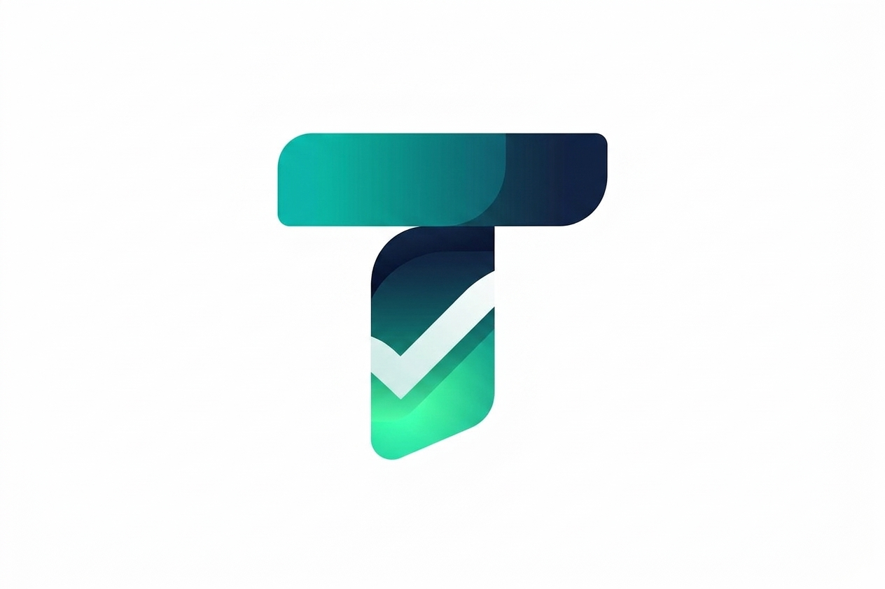
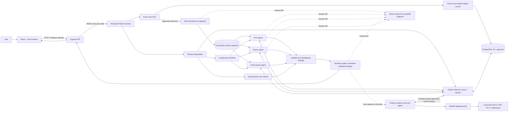

<div align="center">
  
  <h1>TrueLine</h1>
  <p><strong>Evidence-grounded brand review and document correction.</strong></p>
  <p>Manage approved guidance, review content for brand and claims issues, and make targeted, reviewable corrections.</p>
  <p>
    
    
    
    
    
    
    
  </p>
</div>

---

## What TrueLine does

TrueLine helps teams review organization-authored content against approved brand guidance, claims, product facts, and other reference material. Teams add approved sources to a session, submit a draft, and receive a human-reviewable report with cited evidence. Deterministic checks and specialist AI agents cover terminology, tone, factual claims, and visual layout. A separate correction agent can make targeted edits to the original file and use approved-source retrieval only to resolve a specific reported finding.

The repository currently provides a local deployment with one configured organization and one active review session. It is suitable for development and evaluation; authentication, concurrent user sessions, and tenant isolation are not implemented yet.

## At a glance

1. Start a session. The API clears any previous session's indexed knowledge and creates a fresh review scope.
2. Upload reference files and assign document types. Approved files are parsed, rule-extracted once, and indexed; extracted rules and original passages are stored against the approved source version. Upload approved logo references when logo comparison or replacement is needed.
3. Upload a draft to review and optionally select its channel. The backend parses it, runs deterministic checks, and retrieves relevant passages.
4. Tone and Claims agents inspect each draft-text chunk with applicable session rules, deterministic results, and retrieved evidence. The Visual Layout agent reviews available PDF page previews, embedded image assets, and approved logo references against retrieved visual guidance; it does not receive extracted page text. Agents can request bounded, focused RAG searches and reassess with the returned evidence.
5. The backend validates and deduplicates deterministic, tone, claims, and visual findings in a per-review buffer. The Summary agent can prioritize only those findings; the application renders the report from the validated buffer.
   The review badge reports `COMPLETED` or `ERROR`; finding classifications and any incomplete checks are shown separately.
6. If the user requests a corrected version, the correction agent works only on validated findings from the final summary. It inspects the exact target, can search approved sources for that finding, stages an evidence-backed text edit or a supported PDF visual edit, and verifies the result. It can use approved logo assets already uploaded to the session. The backend applies only verified changes to the original DOCX, PDF, TXT, or Markdown file; unsupported or unsafe corrections remain unresolved for review.
7. End the session when finished. The API deletes that session's sources, versions, chunks, and embeddings so a later session starts clean.

## Architecture



### Components

| Component | Responsibility |
| --- | --- |
| `frontend/` | React/Vite interface for sessions, approved reference files and logo assets, review results, and corrected drafts. Summary text is rendered as GitHub-flavored Markdown. |
| `backend/` | Express HTTP API, multipart upload validation, session-aware requests, and a long-lived Python worker bridge. Loads `backend/.env`. |
| `data_ingestion/` | PostgreSQL schema/migrations, source/version management, chunking, embeddings, hybrid search, and ephemeral session cleanup. |
| `rag/parsing/` | Extracts text and location metadata from PDF, DOCX, Markdown, and plain text files. Sparse image-heavy PDF pages use adaptive Tesseract OCR. |
| `rag/rules/` | Evaluates machine-checkable structured rules supplied with an ingested source. Natural-language extracted rules are kept in the separate evidence-linked rulebook and reviewed by specialist agents. |
| `rag/retrieval/` | Adapts the ingestion search interface and retrieves evidence for review passages while preserving source and location information. |
| `rag/agentic/` | Ingestion-time rulebook extraction, LangGraph tone/claims/visual/summary review, and the on-demand finding-scoped correction agent; model roles are configured independently. |

### Review workflow

1. **Ingest references.** Approved references use the existing parsing and OCR pipeline. The extraction agent records explicit rules and facts—including every explicitly stated product price (regular/list, sale, promotional, and per-unit)—with exact quotations, source version, chunk, and page provenance. Prices retain the exact product name, amount, currency, conditions, quantity, and unit; missing values are not inferred. Original passages also continue through chunking and embedding. A single source over 80,000 parsed characters is not sent to rule extraction; its extraction status is marked insufficient, but indexing can continue.
2. **Parse the draft.** The uploaded review file is decoded and parsed into text segments and source locations.
3. **Review extracted rules.** Before specialist agents run, the interface lists the extracted rules applicable to the selected channel. Every rule stays included by default; the reviewer can discard individual rules for this review. Discarded rules are removed from the in-memory review rulebook and are not written back to the approved source.
4. **Check deterministic rules.** The backend loads approved machine-checkable rules for the active session and requested channel, then runs terminology and required-text checks.
5. **Retrieve and investigate.** Parsed passages receive an initial hybrid retrieval snapshot. Tone and Claims process the review text in overlapping chunks with the remaining active-version rulebook entries, deterministic results, and retrieved evidence. Claims is instructed to inventory each checkable assertion and compare product names, prices, currencies, quantities, and other supported facts with approved sources. The Visual Layout agent receives PDF page previews, a bounded set of embedded assets, approved logo references, and relevant visual guidance; it does not receive extracted review text. Tone and Claims can make up to two focused RAG searches per chunk; visual review can make up to two searches. Each search returns up to eight sources. Missing evidence is not proof of falsity.
6. **Validate and consolidate.** Exact review spans and source citations are checked against approved current-session evidence. Each Tone and Claims result is added to its own findings buffer with an exact-duplicate check; duplicate entries merge their validated citations. Distinct findings on the same sentence remain separate. Deterministic and specialist findings are then deduplicated in the per-review summary buffer.
7. **Summarize.** The summary model receives only the validated, deduplicated findings and returns an ordering hint plus a safe proposed correction for eligible findings, keyed to existing finding IDs. It cannot add or reclassify findings. Proposed corrections appear in a review buffer and are included by default; the reviewer can discard individual proposals.
8. **Render.** The API returns structured results and evidence to the frontend, which renders the Markdown report and citations.
9. **Correct on request.** Only after the user clicks **Generate corrected file**, the backend builds a YAML correction plan from the retained proposals and their validated findings, then passes it with those targets to the correction agent. The agent must follow each proposed solution when it is safe and evidence-supported; it can inspect a target, search approved RAG sources using a query scoped to that finding, stage a patch, change a flagged PDF text style, replace an inspected PDF logo with an approved session asset, and verify changes. It can make at most two RAG searches per finding and 12 total, within a limit of 12 model turns and 60 tool calls. Text patches and text-style changes for tone or claims findings must cite an exact source attached to the finding or returned by that finding's search. Visual style changes and logo replacements are limited to the page and target identified by a visual summary finding. With no direct evidence for a text correction, the agent leaves the issue unresolved. It cannot introduce new correction targets. Verified changes are applied to the original DOCX, PDF, TXT, or Markdown file; unsafe or ambiguous corrections remain unresolved.

Rule extraction runs once when each approved reference version is ingested. Tone, claims, and visual review run for each submitted draft; visual review includes comparisons with approved logo assets. The summary model can order findings and suggest correction plans but cannot change the validated finding buffer. Correction runs only on user request and can use RAG only to support a change to a listed finding. Model calls are independently configured per role even when roles use the same Gemini model.

## Requirements

- macOS, Linux, or Windows with Docker Desktop / Docker Engine and Docker Compose
- Node.js and npm (use a current Node.js LTS release)
- Python 3.11 or 3.12
  - A Gemini API key for each enabled model role: extraction, tone, claims, visual, summary, and correction. Visual review uses the Claims model settings when its own values are blank.
- Sufficient disk space and memory for the BGE-M3 dense embedding model. Its dense PyTorch checkpoint is approximately 2.27 GB and is downloaded to the Hugging Face cache on first model initialization; it is not stored in this repository.
- Tesseract OCR with English language data for scanned PDF pages. PyMuPDF and its Python package do not install the Tesseract executable.

The local database uses PostgreSQL 16 with the pgvector extension via the `pgvector/pgvector:pg16` container. It is exposed on host port `5433` to avoid the common local PostgreSQL port `5432`.

## Run locally

Run each service in a separate terminal from the repository root unless a step says otherwise.

### Run the full stack with Docker Compose

Docker Compose starts PostgreSQL with pgvector, the Express API and its Python worker (including Tesseract OCR), and the Vite frontend:

```bash
docker compose up --build
```

Open `http://localhost:5173`; the API health endpoint is `http://localhost:3001/api/health`. The first build installs the application dependencies, and the first backend startup downloads the BGE-M3 model (about 2.27 GB). The model cache and database are kept in named Docker volumes between runs. Press Ctrl+C to stop the services, then use `docker compose down` to remove the containers and network.

To enable model-backed reviews, copy `backend/.env.example` to `backend/.env` and add the Gemini API keys for the agents you use before starting Compose. The app can start without keys, but model calls will fail until the relevant keys are configured. Docker Compose reads this optional file automatically.

### 1. Configure environment

Create the backend environment file and fill in the API keys for the agents you enable:

```bash
cp backend/.env.example backend/.env
```

In `backend/.env`, set a valid value for each of:

```dotenv
TRUELINE_TONE_API_KEY=your_tone_agent_gemini_key
TRUELINE_EXTRACTION_API_KEY=your_extraction_agent_gemini_key
TRUELINE_CLAIMS_API_KEY=your_claims_agent_gemini_key
TRUELINE_VISUAL_API_KEY=your_visual_agent_gemini_key
TRUELINE_SUMMARY_API_KEY=your_summary_agent_gemini_key
TRUELINE_CORRECTION_API_KEY=your_correction_agent_gemini_key
```

The template configures each role to use Google's OpenAI-compatible API endpoint and the same baseline model, `gemini-3.1-flash-lite`. Provider, base URL, model, timeout, and key remain separate variables for each role. The correction model is called only when a user requests a corrected draft. Keep `backend/.env` private; it is ignored by Git. The Gemini-compatible endpoint format is described in [Google's Gemini API documentation](https://ai.google.dev/gemini-api/docs/openai).

`frontend/.env.example` sets `VITE_API_BASE_URL=http://localhost:3001`, which matches the backend default. Copy it only if you need to override that URL:

```bash
cp frontend/.env.example frontend/.env
```

Other backend settings in `backend/.env.example` include `PORT` (API port), `FRONTEND_ORIGIN` (CORS origin), `DATABASE_URL`, `TRUELINE_BRAND_ID` (the configured organization's internal scope), `TRUELINE_ORGANIZATION_NAME` (display/health metadata), and `PYTHON_BIN` (optional Python executable override). The default database URL and local Compose credentials are for development only.

### 2. Install Python dependencies

From the repository root:

```bash
python3.11 -m venv .venv
source .venv/bin/activate
python -m pip install --upgrade pip
pip install -r rag/requirements.txt -r data_ingestion/requirements.txt
```

On Windows PowerShell, activate with `.venv\Scripts\Activate.ps1`. The backend automatically uses this repository `.venv` if present. Otherwise, set `PYTHON_BIN` in `backend/.env` to the Python executable containing these dependencies.

For a non-Docker local run, install Tesseract separately: on macOS use `brew install tesseract`; on Debian/Ubuntu use `sudo apt-get install tesseract-ocr tesseract-ocr-eng`; on Windows install the Tesseract OCR application and ensure its executable is on `PATH`. The Python worker needs the Tesseract executable available. The Docker Compose backend image includes Tesseract. Digital PDF text extraction and DOCX/TXT/Markdown parsing work without Tesseract.

The PDF parser OCRs a page only when native text is sparse and embedded images occupy at least 25% of the page. Tune `TRUELINE_OCR_MIN_CHARS` (default `40`), `TRUELINE_OCR_IMAGE_COVERAGE` (default `0.25`), and `TRUELINE_OCR_DPI` (default `200`, bounded to 120–300) in `backend/.env` if documents need different thresholds. OCR warnings are returned with parsed review documents and reference ingestion results. Reference PDF images are saved under `data_ingestion/extracted_assets/` (or `TRUELINE_ASSET_DIR`) with generated names and page/hash metadata stored on the source version; session reset/end removes these local artifacts. They are private local files with no public serving endpoint. A deployment with ephemeral disk will lose them on restart, so durable object storage is a future deployment requirement. Review-document images are not saved as approved reference assets. Vector-only page graphics are not currently rendered as fallback images.

### 3. Start the database

In a separate terminal, from the repository root:

```bash
cd data_ingestion
docker compose up -d db
```

The default database is `trueline`, user/password `trueline`/`trueline`, at `localhost:5433`. `backend/.env` has the matching `DATABASE_URL`. The Python worker applies pending migrations when it starts.

### 4. Start the API and Python worker

In a separate terminal, from the repository root:

```bash
cd backend
npm install
npm run dev
```

Wait for the `Python RAG worker ready (bge-m3)` message. The first startup initializes the model and downloads its dense checkpoint if it is not already cached. The API is available at `http://localhost:3001`; `http://localhost:3001/api/health` reports worker, embedding, and non-secret agent configuration status.

### 5. Start the frontend

In another terminal, from the repository root:

```bash
cd frontend
npm install
npm run dev
```

Open the Vite URL shown in the terminal (normally `http://localhost:5173`). The frontend communicates with the backend URL in `VITE_API_BASE_URL`.

### 6. Try a review

1. Start a session in the UI.
2. Upload reference files in the knowledge library. Choose a type per file: `brand_guidelines`, `tone_of_voice`, `approved_claims`, `product_facts`, `glossary`, `asset_rules`, `legal_compliance`, or `other_reference`. Add approved logo references when logo comparison or replacement is needed.
3. Wait for ingestion and embedding to finish before navigating to review.
4. Upload a `.txt`, `.md`, `.pdf`, or `.docx` verification document and choose a channel if relevant.
5. Inspect the Markdown summary, deterministic findings, evidence, and citations. End the session to clear its data.

The API accepts one file per request. Reference uploads are limited to 25 MiB; review uploads are limited to 50 MiB, and extracted review text is limited to 300,000 characters. Reviews accept PDF, DOCX, TXT, Markdown, PNG, JPEG, and WebP. Image uploads are OCRed locally for tone and claims review. Each PDF page is rendered for the Visual Layout agent alongside a bounded number of embedded image assets and approved logo references; the visual agent does not receive extracted copy. DOCX page rendering is not supported, so DOCX reviews do not include page-layout analysis. Non-logo visual violations require an explicit cited visual rule; a logo mismatch can be supported by direct comparison with an approved logo reference. Other visual observations may remain unverified. Approved logo references can be PNG, JPEG, or WebP (5 MiB each, up to 12 per session). The correction workflow supports DOCX, PDF, TXT, and Markdown documents up to 100,000 extracted characters; PDF layout and logo corrections are available only for PDF files. Reference assets and review images are stored locally in the active session. Set `TRUELINE_VISUAL_*` variables in `backend/.env` to override the Claims model configuration for visual review. The worker applies `data_ingestion/migrations/004_logos.sql` at startup.

## Embedding and search configuration

The baseline uses **BAAI/bge-m3** through `sentence-transformers`, configured in `backend/.env`:

```dotenv
INGESTION_EMBEDDER=bge-m3
EMBEDDING_MODEL=BAAI/bge-m3
EMBEDDING_REVISION=main
```

BGE-M3 produces normalized dense embeddings of **1,024 dimensions**, matching the database's `vector(1024)` column. The embedding text includes the selected document type so retrieval can use that metadata to distinguish tone guidance, claims, facts, and other sources. The same model and revision must be used to embed sources and search queries. The code records an embedding-model tag and ignores vectors with a different tag during search.

Search combines dense vector distance and PostgreSQL full-text ranking, fused with Reciprocal Rank Fusion. Agent-specific document-type filters focus tone, claims, visual, and correction searches. The current migration does not enable an approximate-nearest-neighbor index; vector search scans eligible rows, so retrieval latency should be measured as the approved corpus grows.

Retrieved child chunks also carry a bounded paragraph-level `parent_context`, derived from the immutable source text and stored offsets at query time. This adds surrounding rule context to the agents while keeping the child chunk as the citation target. It does not alter chunk text, stored vectors, model tags, or require reindexing.

An optional cross-encoder reranking stage can reorder the hybrid candidate pool after RRF. It is disabled by default; set `TRUELINE_RERANKER_ENABLED=1` in `backend/.env` to enable it, and optionally set `TRUELINE_RERANKER_MODEL`. The default scorer is `BAAI/bge-reranker-v2-m3`, which is a separate relevance-scoring model, not an embedding model. Existing BGE-M3 vectors and their 1,024-dimensional schema remain unchanged. If the reranker cannot load or score candidates, search falls back to the original RRF ranking and marks the response `reranker_status: "fallback"`.

For a lightweight local plumbing check, `INGESTION_EMBEDDER=fake` selects a deterministic fake embedder. Fake vectors are **not semantic embeddings**, must not be used to assess retrieval quality, and are incompatible with BGE-M3 vectors. Start a fresh session and re-upload sources after changing the embedder; session reset clears the previous index.

## Agent API configuration

Each model role has an environment namespace. Visual review reuses the Claims model settings and API key by default; set `TRUELINE_VISUAL_*` values to override them. Add keys for other enabled roles in your private `backend/.env`:

| Role | API key | Default retrieval focus |
| --- | --- | --- |
| Rule extraction | `TRUELINE_EXTRACTION_API_KEY` | Runs when an approved reference version is ingested; extracts cited rules and product facts, including prices |
| Tone | `TRUELINE_TONE_API_KEY` | Tone of voice, brand guidelines, glossary |
| Claims | `TRUELINE_CLAIMS_API_KEY` | Approved claims, product facts (including exact price comparisons), brand guidelines, legal/compliance |
| Visual | `TRUELINE_VISUAL_API_KEY` | PDF page layout, embedded-image, and approved-logo review against visual guidance; falls back to Claims settings |
| Summary | `TRUELINE_SUMMARY_API_KEY` | Receives validated, deduplicated findings and returns an ordering hint |
| Correction | `TRUELINE_CORRECTION_API_KEY` | On-demand, summary-finding-scoped corrections; can retrieve approved evidence for a specific finding |

Each role also has its own `*_PROVIDER`, `*_BASE_URL`, `*_MODEL`, and `*_TIMEOUT_SECONDS` variables. All currently use Gemini through `https://generativelanguage.googleapis.com/v1beta/openai/` and `gemini-3.1-flash-lite`; each role can later be changed independently. Local Ollama is also supported per role by setting its provider to `ollama`, its OpenAI-compatible endpoint (normally `http://localhost:11434/v1`), and a model available in Ollama. The API key value for Ollama is not used as a secret. No Gemini key is sent to the browser.

## HTTP API

The Express server listens on `PORT` (default `3001`) and allows the frontend origin in `FRONTEND_ORIGIN` (default `http://localhost:5173`). Upload endpoints use `multipart/form-data`.

| Method and path | Purpose |
| --- | --- |
| `GET /api/health` | Readiness, embedder name, workflow name, and safe agent model configuration (never keys). |
| `POST /api/session/start` | Clear previous indexed knowledge and start the sole active session. |
| `POST /api/session/resume` | Resume the currently active session using JSON `{ "sessionId": "..." }`. |
| `POST /api/session/stop` | End the session and clear all indexed knowledge. JSON `{ "sessionId": "..." }`. |
| `GET /api/knowledge?sessionId=...` | List indexed sources in the session. |
| `GET /api/logos?sessionId=...` | List approved logo references in the session. |
| `POST /api/logos` | Upload one approved logo image (`file`, `sessionId`, optional `title`; PNG, JPEG, or WebP, up to 5 MiB). |
| `GET /api/logos/:logoId/image?sessionId=...` | Read a session-scoped logo image. |
| `DELETE /api/logos/:logoId?sessionId=...` | Remove a session-scoped logo reference. |
| `POST /api/knowledge` | Ingest one file. Form fields include `file`, `sessionId`, `documentType`, optional `title`, optional JSON-array `ruleData`, and optional `approved`. |
| `POST /api/review` | Review one file. Form fields include `file`, `sessionId`, and optional `channel`. |
| `POST /api/review/correct` | Generate a same-format corrected draft on request (DOCX, PDF, TXT, or Markdown). Form fields include the original `file`, `sessionId`, and `reviewData` JSON with the completed summary and findings. |

The session identifier is a temporary scope token, not authentication. Every session-scoped endpoint verifies that it matches the active session and configured organization.

## Structured deterministic rules

Ingestion stores optional `ruleData` records alongside a source version. Approved, active records are loaded by the deterministic rule adapter. Supported rule kinds and fields are defined in `rag/rules/models.py`; for example:

```json
[
  {
    "rule_id": "preferred_product_name",
    "kind": "terminology",
    "mode": "replace_with_preferred",
    "term": "Tru Line",
    "replacement": "Trueline",
    "case_sensitive": false,
    "whole_word": true,
    "severity": "medium",
    "applies_to_channels": []
  }
]
```

The current UI supports reference-file uploads, but does not expose a dedicated structured-rule editor. Rules can be supplied through the API's `ruleData` field. Uploading prose such as a PDF brand book does not automatically extract executable deterministic rules; prose can still be embedded and retrieved as guidance for the agents.

## Data model and session assumptions

- PostgreSQL stores source identity, immutable source versions, parsed canonical text, structured rule JSON, chunks, document types, embedding metadata, and vectors.
- A chunk links to its source and source version and records its document type and location in canonical version text.
- A source is searchable only when its version is active and approved, its chunks have ready embeddings, and the stored model tag matches the configured embedder.
- The current deployment supports **one configured organization and one active session at a time**. Session start clears all indexed knowledge, and session end deletes it. Multi-user access, concurrent sessions, and durable organization-level knowledge are not implemented.
- Database schema and migrations remain in place when session knowledge is cleared. Stopping Docker does not delete its named volume. To deliberately reset the local database volume itself, run `docker compose down -v` from `data_ingestion/`; this deletes database contents.

## Repository layout

```text
TrueLine/
├── assets/truline_logo.png
├── backend/                 Express API and Python worker bridge
├── data_ingestion/          PostgreSQL/pgvector schema and ingestion package
│   ├── migrations/          Versioned SQL schema migrations
│   ├── seed/                Optional sample knowledge records
│   ├── tests/               Ingestion and retrieval tests
│   └── trueline_ingestion/  Chunking, embeddings, persistence, search, sessions
├── frontend/                React + Vite client
├── rag/                     Parsing, deterministic checks, retrieval, LangGraph
└── README.md
```

Useful module guides: [RAG workflow](rag/RAG_WORKFLOW.md), [ingestion contract](data_ingestion/RAG_INGESTION_CONTRACT.md), and [ingestion README](data_ingestion/README.md).

## Troubleshooting

- **Database connection refused on port 5433:** start the database with `docker compose up -d db` from `data_ingestion/` and check `docker compose ps`.
- **Python worker fails during startup:** activate the repository `.venv`, install both requirement files, confirm the database is reachable, and check the error printed by `npm run dev`.
- **Model download or memory failure:** first BGE-M3 initialization downloads model weights and may need several GB of free disk and available memory. For plumbing checks only, use the fake embedder and re-upload sources in a fresh session.
- **Gemini request fails:** confirm the API key is set for the failing role (extraction, tone, claims, visual, summary, or correction) and that its endpoint/model are enabled for the key. Visual review falls back to the Claims settings when its own values are unset.
- **No relevant citations:** verify the source upload finished, is approved, has the right document type, and belongs to the current session. An agent should report insufficient evidence rather than fabricate support.
- **Review gives no deterministic findings:** confirm structured rules were sent as `ruleData`, were approved, and apply to the selected channel. Natural-language rules are not converted automatically.

## Development notes

Start the backend and frontend as described above. Optional ingestion tests use a disposable PostgreSQL database; see `data_ingestion/README.md` for setup. The test fixture drops `knowledge_*` tables, so never point `TEST_DATABASE_URL` at a database containing data you need.

## Current limitations

- No authentication, user accounts, authorization, or multi-tenant isolation; the session token is not an access-control mechanism.
- OCR quality depends on scan quality and the locally installed Tesseract language data. Logo screening compares extracted images with uploaded references and may miss logos that are substantially altered or embedded as page-level vector artwork.
- Model-extracted rulebooks depend on the extraction model and preserve exact supporting quotations; they do not create executable deterministic rules or a dedicated structured-rule editor in the UI.
- Agent outputs can be incomplete or wrong; a human must verify the evidence and conclusions.
- BGE-M3 uses a substantial local model download, and the current exact vector scan should be benchmarked as the source library grows.
- Model choice and endpoint are configured by a trusted local operator in `.env`; the UI does not accept user-supplied model endpoints or API keys.

## License

Distributed under the MIT License. See [LICENSE](LICENSE).
